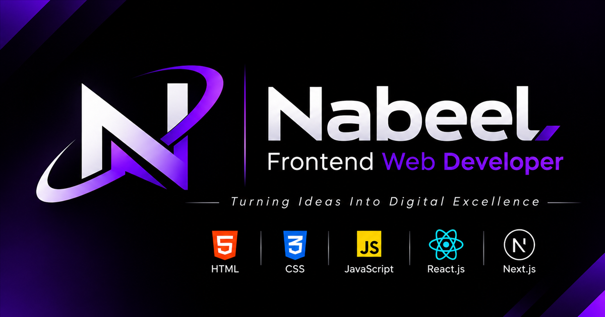

# Nabeel — Frontend Developer Portfolio

A premium, fully responsive portfolio website for **Nabeel**, a frontend web
developer specializing in **React.js & Next.js**. Built with the Next.js App
Router, React, and a hand-crafted dark design system with violet gradients,
glassmorphism, and subtle motion.



## ✨ Features

- Dark, premium visual identity with deep purple / violet accents
- Animated hero with a custom code-window illustration and floating tech chips
- Scroll-aware navigation with active section highlighting, progress bar and
  an animated mobile menu
- Scroll-reveal animations powered by `IntersectionObserver`
- Animated skill cards with proficiency meters
- Three portfolio project cards with preview artwork, tech tags, live demo and
  GitHub buttons
- Six service cards and a call-to-action banner
- Contact form with client-side validation that opens the visitor's email app
  (no backend required), plus copy-email, WhatsApp, GitHub and LinkedIn links
- Fully responsive: mobile, tablet and desktop
- SEO-ready: metadata, Open Graph / Twitter cards, JSON-LD structured data,
  `robots.txt`, sitemap and a custom 404 page
- Accessibility: semantic landmarks, skip link, focus states, ARIA labels and
  `prefers-reduced-motion` support
- Self-hosted variable fonts (Sora + Inter) — no external font requests
- Zero UI dependencies beyond React / Next.js

## 🛠 Tech stack

| Technology | Used for |
| ---------- | -------- |
| Next.js 16 (App Router) | Framework, routing, metadata |
| React 19 | UI components and interactivity |
| JavaScript (ES6+) | Application logic |
| CSS3 | Custom design system, animations, responsive layout |
| HTML5 | Semantic, accessible structure |

## 🚀 Getting started

Requirements: **Node.js 20.9+** and npm.

```bash
# 1. Install dependencies
npm install

# 2. Start the development server
npm run dev
```

Open [http://localhost:3000](http://localhost:3000).

### Production build

```bash
$env:NEXT_PUBLIC_BASE_PATH="/nabeel-portfolio"   # Windows PowerShell
npm run build
```

The static site is written to `out/`. See the deployment section for details.

## 📁 Project structure

```text
nabeel-portfolio/
├─ public/
│  ├─ logo-mark.png          # Transparent brand mark
│  ├─ og.png                 # Social share image (1200×630)
│  └─ projects/              # Project preview artwork (PNG)
├─ src/
│  ├─ app/
│  │  ├─ layout.js           # Metadata, fonts, global layout, JSON-LD
│  │  ├─ page.js             # Page composition
│  │  ├─ not-found.js        # Custom 404
│  │  ├─ robots.js           # robots.txt
│  │  ├─ sitemap.js          # sitemap.xml
│  │  ├─ icon.png            # Favicon / app icon
│  │  └─ styles/             # Design system split by concern
│  │     ├─ base.css         # Tokens, reset, utilities, nav, motion
│  │     ├─ hero.css         # Hero + About
│  │     ├─ work.css         # Skills, Projects, Services
│  │     ├─ contact-footer.css
│  │     └─ responsive.css   # Breakpoints + reduced motion
│  ├─ components/            # Reusable UI components
│  └─ data/site.js           # All content & contact configuration
├─ jsconfig.json             # `@/` import alias
├─ next.config.mjs
└─ package.json
```

## ⚙️ Customization

Almost everything lives in **`src/data/site.js`**:

1. **Contact details** — the real email, WhatsApp number and GitHub profile are
   already configured in `src/data/site.js`. The LinkedIn URL is still a
   placeholder — replace `https://linkedin.com/in/your-username` when your
   profile is ready.
2. **Domain** — `siteConfig.url` points at the live GitHub Pages site
   (`https://aminbaloch984-design.github.io/nabeel-portfolio`). Update it if you
   move to a custom domain.
3. **Projects** — update titles, descriptions, tech stacks and replace the
   placeholder `live` / `github` links with real URLs.
4. **Brand logo** — replace `public/logo-mark.png` (transparent PNG) and
   `src/app/icon.png` (square icon) to use a different logo.
5. **Social share image** — replace `public/og.png` (1200×630 recommended).

The contact form does not post to a server. On submit it validates the fields
and opens the visitor's default email app with the message pre-filled, so the
site works as a static deployment with no API keys or backend.

## 🌍 Deployment

The portfolio is live at
**[https://aminbaloch984-design.github.io/nabeel-portfolio/](https://aminbaloch984-design.github.io/nabeel-portfolio/)**
on GitHub Pages.

### How it is deployed

The site is a fully static export. GitHub Pages project sites are served from a
sub-path, so the build uses `NEXT_PUBLIC_BASE_PATH`:

```bash
# Windows (PowerShell)
$env:NEXT_PUBLIC_BASE_PATH="/nabeel-portfolio"; npm run build

# macOS / Linux
NEXT_PUBLIC_BASE_PATH=/nabeel-portfolio npm run build
```

The generated `out/` folder is published to the `gh-pages` branch, and GitHub
Pages is configured to serve that branch.

### Deploying your own copy

1. Fork or clone the repository.
2. Set `NEXT_PUBLIC_BASE_PATH` to `/<your-repo-name>` and build.
3. Push the contents of `out/` to a `gh-pages` branch.
4. In **Settings → Pages**, choose the `gh-pages` branch as the source.

### Other platforms

The same `out/` folder works on Netlify, Cloudflare Pages or any static host.
When the site is served from a domain root, build without the base path:

```bash
npm run build
```

## ✅ Quality checks

- `npm run build` completes without errors
- No external asset or font requests at runtime
- Responsive from 320 px to 1920 px+
- Keyboard accessible navigation, form fields and links
- Motion disabled automatically for visitors who prefer reduced motion

---

© 2026 Nabeel. All Rights Reserved.
